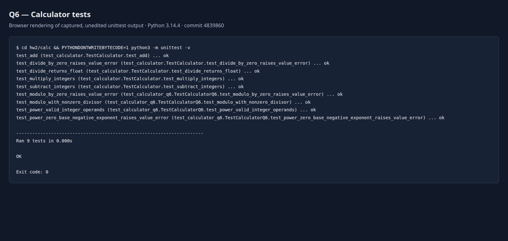

# Question 6: agentic TDD for modulo and power

## Roles, scope, and reproduction

The reviewer is **Codex**, model **gpt-6.1-sol**, running in the interactive Codex environment with CLI **0.164.0**. Yuankai delegated the review and commit role to Codex; this document does not claim that Yuankai personally reviewed the tests. The separate coding agent is **Codex CLI 0.164.0**, model **gpt-6.1-sol**, session `01a1789e-5c60-7a30-ad1d-76609a6da601`. It began as a fresh `codex exec --json` session with no reviewer conversation and is continued with its explicit session ID. Model and version were verified from local session metadata and `codex --version`.

The reviewer authors prompts, review notes, commits, test evidence, and this narrative. All Q6 automated tests and production changes are authored by the separate coding agent. The Q1 test file remains unchanged. Python is **3.14.4**, with standard-library `unittest` and integer operands as in Q1. Run from the repository root:

```sh
cd hw2/calc
PYTHONDONTWRITEBYTECODE=1 python3 -m unittest -v
```

The complete prompt and response record, including reported tool commands and output, is in [agent-transcript/transcript.md](agent-transcript/transcript.md). Raw, unedited `--json` event streams are saved for each invocation and concatenated in [agent-transcript/session.jsonl](agent-transcript/session.jsonl). The initial prompt intentionally withheld the user's prescribed edge-case answers.

## Environment interruption before cycle 1

The initial invocation could not read files: both its shell attempts failed with `app-server socket directory must be a user-owned directory with mode 0700`. No tests, implementation, or commits were created. This is an environment interruption, not a failing automated test or a TDD-rule violation. The reviewer retried the same session with subprocess-only `--enable use_legacy_landlock` and the enclosing managed workspace sandbox still active. No global permissions or configuration were changed. Both prompts and all emitted responses are preserved.

The legacy-mode retry also failed before file access: `filesystem-restricted execution requires bubblewrap to isolate app-server sockets`. The reviewer removed that option and obtained approval to launch the child CLI outside the enclosing command sandbox while retaining the child's normal `workspace-write` sandbox. The third invocation, still the same agent session and without the prescribed behavioral answers, successfully produced the first test. Subsequent invocations disable unrelated Apps/plugins to avoid unnecessary startup work. Exact launch arguments are preserved in `agent-transcript/launches.jsonl`. Git index writes also require the approved external command runner because the managed command sandbox mounts worktree Git metadata read-only.

## Cycle 1: signed modulo with nonzero divisors

- Test and review: `test_modulo_with_nonzero_divisor` has seven subtests specifying a single remainder rule: ordinary division, reversed magnitudes, exact divisibility, a zero dividend, and every negative-operand sign combination. Its literal expectations distinguish Python's divisor-sign rule from truncation-based remainder. The agent proposed that convention for review without first asking the reviewer to select it; it matches the user's decision. The test was approved unchanged.
- Red: [cycle-1-red.txt](evidence/cycle-1-red.txt), exit 1. Five Q1 methods pass; the sixth method reports seven `AttributeError` subtest errors because `modulo` is absent. Subtests allow every sign case to demonstrate red independently. The test and red evidence were committed as **243976b** before implementation authorization.
- Change and green: the agent added only `return a % b` in the new `modulo` method. [cycle-1-green.txt](evidence/cycle-1-green.txt), exit 0, shows all 6 methods passing. The separate implementation commit is **60f1856**. No committed test changed, no power code or special zero-divisor policy was added, and no refactor was necessary.
- Rule check: no observed TDD-rule violation. The environment failures described above produced no test or implementation edits and are not counted as red results.

After this cycle, the reviewer merged `main` into the feature branch as explicitly requested by the orchestrator, bringing in the shared CI, ruff, and 100% branch-coverage configuration. This merge does not alter the Q1 test file or the reviewed Q6 test.

## Cycle 2: modulo by zero

- Test and review: the agent first asked whether a zero divisor should produce `ValueError`, native `ZeroDivisionError`, or another exception. The reviewer answered the user's `ValueError` decision and approved the proposed fixed message `Cannot modulo by zero`. Only then did the agent write `test_modulo_by_zero_raises_value_error`, one method with positive, negative, and zero dividends. The anchored exception/message checks accurately express the approved contract and were accepted unchanged.
- Red: [cycle-2-red.txt](evidence/cycle-2-red.txt), exit 1. Seven methods run; the new method has three subtest errors because `%` raises `ZeroDivisionError`, while all 6 earlier methods pass. The test and red evidence were committed as **ffb1041** before the guard was authorized.
- Change and green: the agent added `if b == 0: raise ValueError("Cannot modulo by zero")` before `%`. All 7 methods pass in [cycle-2-green.txt](evidence/cycle-2-green.txt), exit 0. Implementation commit **0ce2eec** is separate from and later than the test commit.
- Refactor and rule check: none needed; no observed TDD-rule violation or unapproved test edit. The exception and message were explicitly discussed before the test, rather than decided without asking.

## Cycle 3: zero base with a negative exponent

- Test and review: before editing, the agent asked which exception and message to use. The reviewer supplied the user's ValueError decision and approved the proposed message `Cannot raise zero to a negative power`. The reviewer also answered the previously deferred 0**0 and nonzero-base negative-exponent choices, reserving their numerical tests for cycle 4. Exactly one new method, `test_power_zero_base_negative_exponent_raises_value_error`, checks exponents -1, -2, and -5 against the same invalid-domain rule. The existing tests and production file were unchanged; the test was approved without edits.
- Red: [cycle-3-red.txt](evidence/cycle-3-red.txt), exit 1. All 7 previous methods pass; the new method reports three AttributeError subtest errors because `power` is absent. Test commit **a5480fe** precedes authorization of the guard.
- Change and green: the agent added only the invalid-domain guard to `power`; valid inputs temporarily fall through to None. This deliberately incomplete intermediate step was explicitly authorized so that the numerical operation could not precede its tests. [cycle-3-green.txt](evidence/cycle-3-green.txt), exit 0, shows 8 passing methods. Separate implementation commit: **8584cb9**.
- Refactor and rule check: no refactor, committed test edits, numerical exponentiation, or observed TDD-rule violation. The temporary fall-through is not the final API.

## Cycle 4: valid numerical exponentiation

- Test and review: `test_power_valid_integer_operands` adds one numerical rule with 14 literal examples. It covers ordinary positive exponents, negative-base parity, zero base with positive exponent, zero exponents including power(0, 0) == 1, and negative exponents for nonzero bases including power(2, -1) == 0.5. All five negative-exponent cases assert float type as well as value; (1, -4) distinguishes 1 from 1.0 by type. The expected fractions are exact binary fractions. The reviewer approved the test unchanged.
- Red: [cycle-4-red.txt](evidence/cycle-4-red.txt), exit 1. The new method has 14 failing subtests because the guard-only method returns None; all 8 earlier methods pass. Test commit **fc7f34e** precedes authorization of general numerical power.
- Change and green: the agent added only `return a ** b` after the existing guard. [cycle-4-green.txt](evidence/cycle-4-green.txt), exit 0, shows all 9 methods passing. Separate implementation commit: **4839860**. There are no test-input-specific branches.
- Refactor and rule check: no refactor was needed and no TDD-order or committed-test rule was violated. The reviewer inspected the diff and independently ran the suite before the feat commit.

## Rule violations

No observed TDD-rule violations occurred in the four completed cycles. The coding agent never wrote the relevant implementation before its reviewed test commit, added more than one test method per cycle, weakened or deleted a test, changed an already committed test, or committed its own changes. The reviewer independently checked the diffs and red/green runs at each boundary. Subtests cover examples of a single rule within each method; they are not separately added test methods.

The initial sandbox failures produced no edits and are recorded as environment interruptions. They are not presented as red results. The agent's initial choice of a modulo sign convention is an unasked decision, reported below, rather than hidden as a reviewer-supplied requirement. No corrective test rewrite or refactor commit was needed.

## Decisions the agent made without asking

| Required decision | What actually happened before implementation | Automated contract |
| --- | --- | --- |
| Modulo with negative operands | In turn 03 the agent proposed Python's divisor-sign convention without first asking the reviewer to select it. It explicitly submitted the proposal for approval. The reviewer accepted it because it matches the user's choice. | Cycle 1 includes modulo(-7, 3) == 2, modulo(7, -3) == -2, and both operands negative. |
| Modulo by zero | The agent asked in turn 05. The reviewer answered ValueError in turn 06 and approved the agent's proposed fixed message. This was not an unasked choice. | Cycle 2 checks ValueError and its approved message for three dividend signs. |
| power(0, 0) | The agent deferred this contract rather than inventing it, and explicitly identified it as unresolved in turn 08. The reviewer supplied 1 in turn 09 before numerical power was implemented. | Cycle 4 includes the literal expectation 1. |
| Negative exponents | In turn 08 the agent asked about zero-base invalid inputs and deferred nonzero-base numeric results. The reviewer supplied float results for nonzero bases and ValueError for zero base in turn 09, approving the proposed fixed exception message. Neither answer was silently assumed. | Cycle 3 checks the invalid zero-base domain; cycle 4 checks values and float types for nonzero bases. |

The agent selected representative example operands and test names within the approved rules. Those choices do not add a new behavior contract. There were no other observed unasked API decisions.

## Final review and verification

The required `codex review --base main` ran with Codex CLI 0.164.0, model gpt-6.1-sol, in a separate read-only review session. It inspected the diff and ran the nine tests successfully. Its result was: no actionable regression identified. The reviewer agrees: native `%` and `**` implement the integer-operand rules, and the two explicit guards enforce the selected invalid-input policy. There were no findings to reject or fix. The exact final review response is preserved in [code-review.txt](evidence/code-review.txt).

The simplification pass found no necessary refactor: both additions are direct operations with one guard each, without duplicated algorithms or test-input special cases. The narrative records only observed decisions, edits, and results. Full transcripts and raw output are retained because they are submission evidence.

Final local verification passed all 9 methods, ruff, and 100% statement and branch coverage (19 statements, 6 branch destinations, zero misses). The commands match the CI workflow merged from main; full output is in [final-ci-checks.txt](evidence/final-ci-checks.txt). These finite examples and coverage do not prove correctness over every integer. The supported scope here is integer operands, including negative integer exponents, consistent with Q1.

The history audit in [history-audit.txt](evidence/history-audit.txt) checks every Q6 test/feat pair: one new method per test commit; earlier tests unchanged; implementation unchanged in test commits; tests unchanged in feat commits; captured red/green source hashes matching their commits; and the Q1 test file byte-for-byte unchanged throughout. Each `cycle-N-red.json`/`green.json` also records the actual capture time, then-current HEAD, exit code, and source SHA-256 values.

[final-tests.txt](evidence/final-tests.txt) is the actual final unittest output. The screenshot below is a browser rendering of that unedited output, not a reconstructed terminal session; its [HTML source](evidence/final-tests.html) is included. It was captured after the final implementation commit 4839860, with all nine methods and the OK result visible.



## Complete test listings

### Q1 tests, unchanged: hw2/calc/test_calculator.py

```python
import unittest

from calculator import Calculator


class TestCalculator(unittest.TestCase):
    def test_add(self):
        calc = Calculator()
        self.assertEqual(calc.add(2, 3), 5)

    def test_subtract_integers(self):
        calc = Calculator()
        self.assertEqual(calc.subtract(7, 3), 4)
        self.assertEqual(calc.subtract(3, 7), -4)
        self.assertEqual(calc.subtract(-7, 3), -10)
        self.assertEqual(calc.subtract(7, -3), 10)
        self.assertEqual(calc.subtract(-7, -3), -4)
        self.assertEqual(calc.subtract(7, 0), 7)
        self.assertEqual(calc.subtract(0, 7), -7)
        self.assertEqual(calc.subtract(0, 0), 0)
        self.assertEqual(calc.subtract(7, 7), 0)

    def test_multiply_integers(self):
        calc = Calculator()
        self.assertEqual(calc.multiply(7, 3), 21)
        self.assertEqual(calc.multiply(3, 7), 21)
        self.assertEqual(calc.multiply(-7, 3), -21)
        self.assertEqual(calc.multiply(7, -3), -21)
        self.assertEqual(calc.multiply(-7, -3), 21)
        self.assertEqual(calc.multiply(7, 0), 0)
        self.assertEqual(calc.multiply(0, 7), 0)
        self.assertEqual(calc.multiply(0, 0), 0)
        self.assertEqual(calc.multiply(7, 1), 7)

    def test_divide_returns_float(self):
        calc = Calculator()
        exact = calc.divide(6, 3)
        self.assertIsInstance(exact, float)
        self.assertEqual(exact, 2.0)
        fraction = calc.divide(7, 2)
        self.assertIsInstance(fraction, float)
        self.assertEqual(fraction, 3.5)
        self.assertEqual(calc.divide(-7, 2), -3.5)
        self.assertEqual(calc.divide(7, -2), -3.5)
        self.assertEqual(calc.divide(-7, -2), 3.5)
        zero = calc.divide(0, 7)
        self.assertIsInstance(zero, float)
        self.assertEqual(zero, 0.0)
        self.assertEqual(calc.divide(0, -7), 0.0)
        self.assertEqual(calc.divide(7, 1), 7.0)

    def test_divide_by_zero_raises_value_error(self):
        calc = Calculator()
        with self.assertRaisesRegex(ValueError, "^Cannot divide by zero$"):
            calc.divide(7, 0)
        with self.assertRaisesRegex(ValueError, "^Cannot divide by zero$"):
            calc.divide(-7, 0)
        with self.assertRaisesRegex(ValueError, "^Cannot divide by zero$"):
            calc.divide(0, 0)


if __name__ == "__main__":
    unittest.main()
```

### Q6 tests: hw2/calc/test_calculator_q6.py

```python
import unittest

from calculator import Calculator


class TestCalculatorQ6(unittest.TestCase):
    def test_modulo_with_nonzero_divisor(self):
        calc = Calculator()
        for dividend, divisor, expected in (
            (7, 3, 1),
            (3, 7, 3),
            (6, 3, 0),
            (0, 3, 0),
            (-7, 3, 2),
            (7, -3, -2),
            (-7, -3, -1),
        ):
            with self.subTest(dividend=dividend, divisor=divisor):
                self.assertEqual(calc.modulo(dividend, divisor), expected)

    def test_modulo_by_zero_raises_value_error(self):
        calc = Calculator()
        for dividend in (7, -7, 0):
            with self.subTest(dividend=dividend):
                with self.assertRaisesRegex(ValueError, "^Cannot modulo by zero$"):
                    calc.modulo(dividend, 0)

    def test_power_zero_base_negative_exponent_raises_value_error(self):
        calc = Calculator()
        for exponent in (-1, -2, -5):
            with self.subTest(exponent=exponent):
                with self.assertRaisesRegex(
                    ValueError, "^Cannot raise zero to a negative power$"
                ):
                    calc.power(0, exponent)

    def test_power_valid_integer_operands(self):
        calc = Calculator()
        for base, exponent, expected in (
            (2, 3, 8),
            (3, 4, 81),
            (5, 1, 5),
            (-2, 3, -8),
            (-2, 4, 16),
            (0, 3, 0),
            (5, 0, 1),
            (-5, 0, 1),
            (0, 0, 1),
            (2, -1, 0.5),
            (2, -3, 0.125),
            (-2, -3, -0.125),
            (-2, -2, 0.25),
            (1, -4, 1.0),
        ):
            with self.subTest(base=base, exponent=exponent):
                result = calc.power(base, exponent)
                self.assertEqual(result, expected)
                if exponent < 0:
                    self.assertIsInstance(result, float)
```

## Final Calc: hw2/calc/calculator.py

```python
class Calculator:
    def add(self, a, b):
        return a + b

    def subtract(self, a, b):
        return a - b

    def multiply(self, a, b):
        return a * b

    def divide(self, a, b):
        if b == 0:
            raise ValueError("Cannot divide by zero")
        return a / b

    def modulo(self, a, b):
        if b == 0:
            raise ValueError("Cannot modulo by zero")
        return a % b

    def power(self, a, b):
        if a == 0 and b < 0:
            raise ValueError("Cannot raise zero to a negative power")
        return a ** b
```

## Git history

The following actual snapshots were captured at the final implementation commit 4839860. A documentation/evidence-only commit follows this snapshot. In chronological first-parent order, every reviewed test commit appears before its matching implementation commit:

```text
$ git log --first-parent --reverse --oneline a4ef434..HEAD
243976b test: cycle 1 define signed modulo for nonzero divisors
60f1856 feat: cycle 1 implement signed modulo
a0172a2 merge: incorporate main calculator CI checks
ffb1041 test: cycle 2 require ValueError for modulo by zero
0ce2eec feat: cycle 2 reject modulo by zero with ValueError
a5480fe test: cycle 3 define invalid zero-base negative powers
8584cb9 feat: cycle 3 reject zero raised to a negative power
fc7f34e test: cycle 4 define valid integer exponentiation
4839860 feat: cycle 4 implement general integer exponentiation
```

Full `git log --oneline` at that point, newest first (including changes merged from main):

```text
4839860 feat: cycle 4 implement general integer exponentiation
fc7f34e test: cycle 4 define valid integer exponentiation
8584cb9 feat: cycle 3 reject zero raised to a negative power
a5480fe test: cycle 3 define invalid zero-base negative powers
0ce2eec feat: cycle 2 reject modulo by zero with ValueError
ffb1041 test: cycle 2 require ValueError for modulo by zero
a0172a2 merge: incorporate main calculator CI checks
60f1856 feat: cycle 1 implement signed modulo
243976b test: cycle 1 define signed modulo for nonzero divisors
e222172 Merge Q7: tests-only Calc and metamorphic properties
7f6cdf8 test(hw2): validate tests-only Calc with metamorphic properties
bdbfb18 Merge Q4/Q5: refactoring and fault repair in Requests
888ee91 Complete HW2 Q4 refactoring and Q5 fault repair experiments
0587d03 Merge Q2/Q3: CI, coverage, lint, build-break experiments
364067b docs(hw2): archive review, AI audit trail, and final coverage artifact
91febef docs(hw2): record CI experiments, blind repair transcripts, and verification evidence
53477b4 fix(q3): remove unused import without weakening verification gates
3e30db0 experiment(q3): enforce coverage and lint with an intentional unused import
b3b10eb fix(q2): restore subtraction using independently verified agent repair
5e42bbc experiment(q2): repeat subtraction fault for blind agent repair
4fe8364 Revert "experiment(q2): introduce subtraction fault for manual recovery"
b51677c experiment(q2): introduce subtraction fault for manual recovery
cf50171 ci: run calculator unittest on every push and pull request
a4ef434 Merge Q1: TDD subtract, multiply, divide
5e19e41 docs: record cycle review and final passing verification
98faad2 docs: describe cycles 1-4 with evidence and commit history
82ba76a feat: cycle 4 reject division by zero with ValueError
8a14507 test: cycle 4 require ValueError for division by zero
d42eac3 feat: cycle 3 implement true division
00acc47 test: cycle 3 define true division with float results
b97df3d feat: cycle 2 implement integer multiplication
bff3221 test: cycle 2 define integer multiplication and boundaries
ceedfb9 feat: cycle 1 implement integer subtraction
4a37dda test: cycle 1 define integer subtraction and boundaries
8a905ca feat: cycle 0 establish add-only calculator baseline
934a95e chore: initial commit with hw2 files
```
